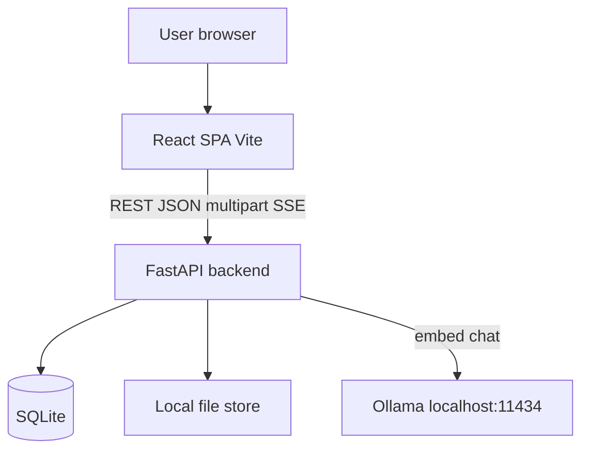
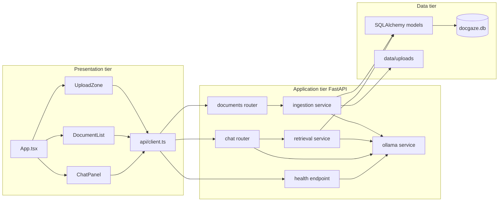
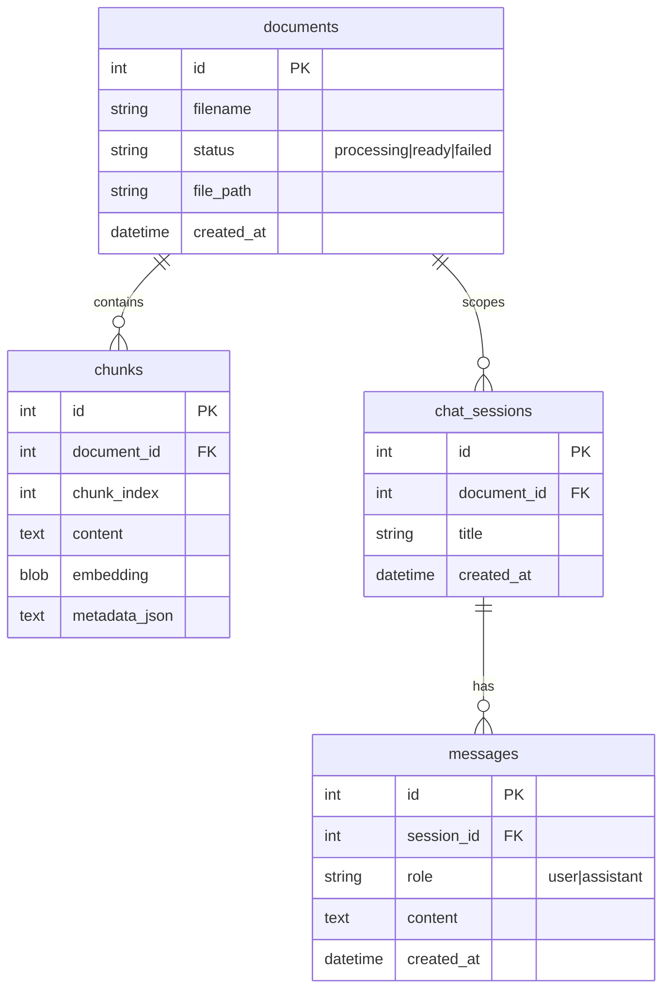
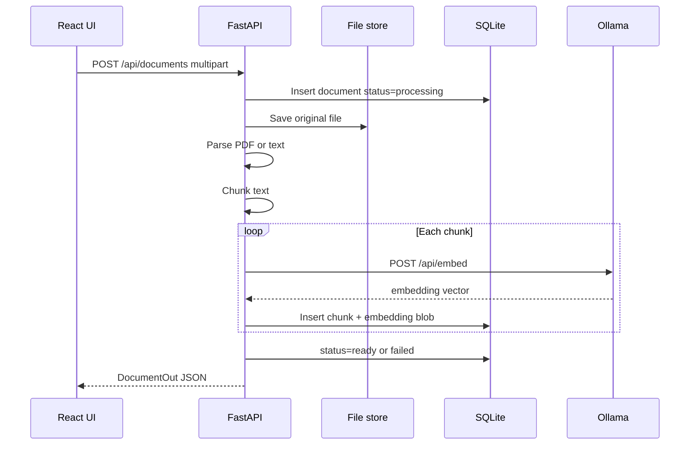
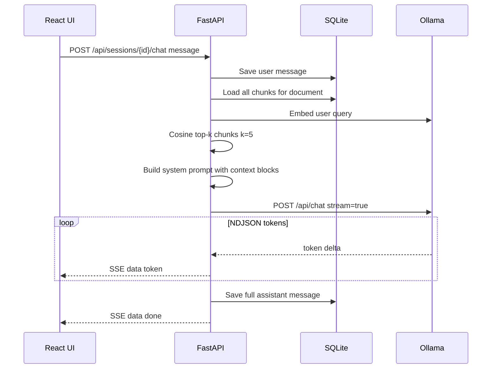
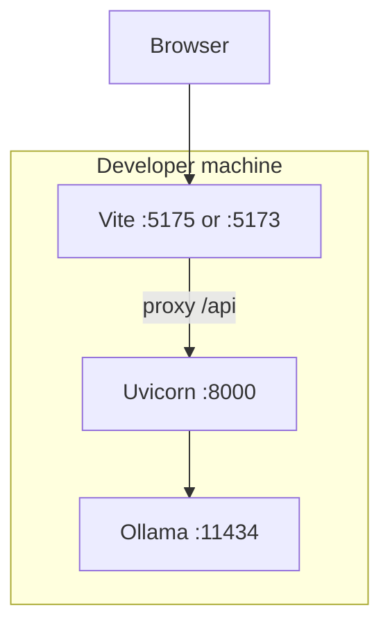

# DocGaze — High-Level Design (HLD)

## 1. Purpose and scope

DocGaze is a **local, single-user** web application that lets users upload documents (PDF, plain text, Markdown), index them for semantic search, and **chat with answers grounded in document content** using retrieval-augmented generation (RAG).

| In scope (MVP) | Out of scope (MVP) |
|----------------|-------------------|
| Upload and delete documents | Multi-user auth / RBAC |
| Per-document chat sessions | Multi-document chat in one session |
| Streaming assistant replies | Cloud LLM providers |
| SQLite persistence | Dedicated vector database |
| Ollama for embed + chat | Background job queue for ingest |

---

## 2. System context



**Runtime assumptions**

- All components run on the developer machine (or a single host).
- Ollama must expose **chat** and **embedding** APIs and have the configured models pulled.
- No authentication layer; the API trusts any client that can reach it (suitable for local dev only).

---

## 3. Logical architecture

Three tiers plus an external inference service:



### 3.1 Presentation tier (`frontend/`)

| Component | Responsibility |
|-----------|----------------|
| `App.tsx` | Orchestrates health, document list, selection, session creation, polling while `processing` |
| `UploadZone` | Drag/drop and file picker; calls `POST /api/documents` |
| `DocumentList` | Lists documents and status; delete and select |
| `ChatPanel` | Message history, streaming UI, disabled states for non-ready docs |
| `api/client.ts` | HTTP client; SSE-style parsing for `POST /api/sessions/{id}/chat` |
| `vite.config.ts` | Dev proxy `/api` → `http://127.0.0.1:8000` |

### 3.2 Application tier (`backend/app/`)

| Module | Responsibility |
|--------|----------------|
| `routers/documents.py` | Upload, list, get, delete documents |
| `routers/chat.py` | Sessions, message history, streaming chat |
| `services/parsers.py` | Extract text from PDF (`pypdf`) and text/md files |
| `services/chunking.py` | Fixed-size overlapping chunks (~800 chars, ~100 overlap) |
| `services/ingestion.py` | Persist file, chunk, embed via Ollama, store vectors |
| `services/retrieval.py` | Query embedding, cosine top-k, RAG prompt assembly |
| `services/ollama.py` | Health, `/api/embed` (fallback `/api/embeddings`), `/api/chat` stream |
| `services/embeddings_store.py` | float32 blob serialize / cosine similarity |
| `config.py` | Ollama URLs, model names, chunk params, CORS, paths |

### 3.3 Data tier

| Store | Contents |
|-------|----------|
| **SQLite** (`backend/data/docgaze.db`) | Documents, chunks (+ embeddings), chat sessions, messages |
| **Filesystem** (`backend/data/uploads/{document_id}/`) | Original uploaded files for re-processing |

---

## 4. Data model (conceptual)



**Document lifecycle:** `processing` → `ready` (chunks + embeddings stored) or `failed` (`error_message` set).

---

## 5. Key flows

### 5.1 Document ingestion (upload)



Ingest runs **synchronously** in the upload request (acceptable for small/medium files).

### 5.2 RAG chat (streaming)



**Retrieval:** All chunk embeddings for one document are loaded into memory; NumPy computes cosine similarity against the query vector. No approximate nearest-neighbor index.

**Prompt policy:** System message instructs the model to answer only from provided context and cite chunk numbers; admit when the answer is not in the document.

---

## 6. API surface (summary)

| Method | Path | Purpose |
|--------|------|---------|
| GET | `/api/health` | DB + Ollama readiness (models + test embed) |
| POST | `/api/documents` | Upload file |
| GET | `/api/documents` | List documents |
| GET | `/api/documents/{id}` | Document detail |
| DELETE | `/api/documents/{id}` | Delete document, chunks, sessions, files |
| POST | `/api/documents/{id}/sessions` | Create chat session |
| GET | `/api/sessions/{id}/messages` | Chat history |
| POST | `/api/sessions/{id}/chat` | Stream reply (SSE: `token`, `done`, `error`) |

OpenAPI: `http://127.0.0.1:8000/docs` when the backend is running.

---

## 7. Deployment view (local dev)



**Configuration** (`backend/.env` from `.env.example`):

- `OLLAMA_BASE_URL`, `OLLAMA_CHAT_MODEL`, `OLLAMA_EMBED_MODEL`
- `DATABASE_URL`, `TOP_K_CHUNKS`, chunk size/overlap via `config.py`

---

## 8. Cross-cutting concerns

| Concern | Current approach |
|---------|------------------|
| **Security** | No auth; CORS limited to Vite origin; not production-hardened |
| **Observability** | Uvicorn access logs; no structured metrics |
| **Error handling** | Failed ingest sets `document.status=failed`; chat streams `error` events |
| **Concurrency** | Sync SQLAlchemy sessions; assistant message saved in a new DB session after stream |
| **Scalability** | Single-node; sequential embedding on ingest; full-doc vector scan per query |

---

## 9. Technology stack

| Layer | Technology |
|-------|------------|
| UI | React 19, TypeScript, Vite 6 |
| API | FastAPI, Uvicorn, Pydantic |
| ORM / DB | SQLAlchemy 2.x, SQLite |
| PDF | pypdf |
| Vectors | NumPy (cosine similarity) |
| LLM / embeddings | Ollama (local HTTP) |
| HTTP client (backend) | httpx |

---

## 10. Evolution paths (not implemented)

Reasonable next steps if the product grows beyond MVP:

1. **Async ingest** — background worker (Celery/RQ) and webhook or poll for `ready`.
2. **Vector index** — sqlite-vec, pgvector, or dedicated store for large corpora.
3. **Auth** — API keys or OAuth; tenant-scoped documents.
4. **Multi-doc sessions** — retrieve across a collection with document metadata in context.
5. **Production deploy** — reverse proxy, HTTPS, object storage for uploads, managed DB.

---

## 11. Repository map

```
docgaze/
  docs/ARCHITECTURE_HLD.md    # this document
  frontend/src/               # React UI
  backend/app/
    main.py                   # app factory, CORS, health
    models.py                 # ORM entities
    routers/                  # HTTP adapters
    services/                 # domain + RAG + Ollama
  backend/data/               # runtime DB + uploads (gitignored)
```

---

*Document version: aligns with MVP implementation in the DocGaze monorepo.*
